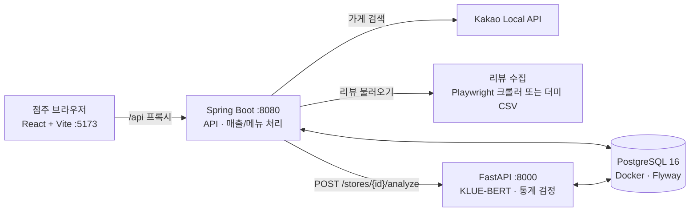
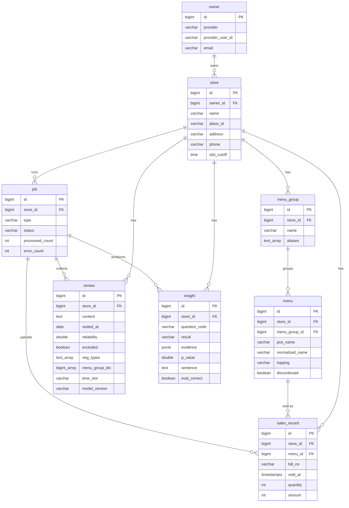

[README (1).md](https://github.com/user-attachments/files/35138570/README.1.md)
# 장사어때

**리뷰-매출 연계 분석을 통한 소상공인 의사결정 지원 시스템**

점주가 POS 매출 파일을 올리고 네이버 플레이스 리뷰를 불러온 뒤 '분석하기'를 누르면,
리뷰에 담긴 손님 반응을 매출 숫자와 연결해서 확인할 점을 근거 수치와 함께 리포트로 보여 줍니다.

> 동국대학교 WISE캠퍼스 컴퓨터공학과 종합설계(졸업작품) · 개인 프로젝트 · 지도교수 박소현
> 📄 [전시 포스터 (PDF)](./장사어때%20포스터.pdf)


## 📌 주요 기능

점주가 쓰는 흐름 그대로입니다.

| 단계 | 화면 | 하는 일 |
|---|---|---|
| 1 | 매장 등록 | 가게 이름으로 검색(카카오 로컬 API) → "이곳이 맞나요?" 확인 후 등록 |
| 2 | 매출 업로드 | POS 매출 CSV 업로드. 같은 영수증 줄은 다시 올려도 한 번만 저장 |
| 3 | 메뉴 정리 | POS 메뉴명을 메뉴군으로 자동 정리(옵션 · 토핑 · 수량 · 세트 표기 분리), 점주가 합치기 · 별칭 추가 · 단종 처리 |
| 4 | 리뷰 불러오기 | 네이버 플레이스 공개 리뷰 수집 → 분석 파이프라인으로 노이즈 제외 · 불만 유형 · 메뉴 · 시간대 태깅 |
| 5 | 분석 리포트 | 메뉴 · 시간대 · 기간별 9개 질문 + 반복 불만 판정, 근거 수치와 p값 표시, 점주가 결과마다 "새로운가 / 맞는가 / 실행할 만한가" 평가 |


## 🏗 시스템 구성



- **Spring Boot**: 매장 · 메뉴 · 매출 · 리뷰 저장과 화면용 API. 분석은 FastAPI 서버에 요청하고 결과를 받아 옵니다.
- **FastAPI**: 리뷰 분석 파이프라인과 리뷰-매출 연계 분석을 실행하고, 결과를 같은 DB의 `review` · `insight` 테이블에 저장합니다.
- 분석과 리뷰 불러오기는 **동기 방식**으로 처리합니다.


## 🛠 기술 스택

| 구분 | 기술 |
|---|---|
| Frontend | React 19, Vite 6, lucide-react |
| Backend | Java 21, Spring Boot 4.1, Spring Data JPA, Flyway |
| 분석 서버 | Python, FastAPI, pandas, SciPy, Transformers, PyTorch |
| 모델 | KLUE-BERT (`klue/bert-base`) 파인튜닝 2종 |
| 수집 | Playwright (네이버 플레이스 모바일 리뷰) |
| DB / 인프라 | PostgreSQL 16, Docker Compose |
| 외부 API | Kakao Local (장소 검색) |


## 🔍 리뷰 분석 파이프라인

리뷰 한 건이 아래 4단계를 거칩니다.

1. **규칙 기반 1차 필터**: URL · 광고, 이벤트 문구, 다른 가게 이야기, 의미 없는 글, 같은 작성자 복붙을 걸러 `exclude_reason`에 기록
2. **노이즈 분류 (KLUE-BERT)**: 정상 리뷰일 확률을 `reliability`로 저장, 0.3 미만이면 제외
3. **부정 유형 분류 (KLUE-BERT, 멀티라벨)**: 맛 · 가격 · 서비스 · 위생 · 대기시간 · 분위기 6개 유형 확률 → 0.5 이상인 유형을 `neg_types`로 저장
4. **메뉴 · 시간대 태깅**: 메뉴군 이름 · 별칭으로 언급 메뉴를 찾고, 메뉴별 칭찬 · 불만을 구분 (`praised` / `blamed`). 시간대는 네이버의 "점심/저녁에 방문" 표기를 먼저 쓰고, 없으면 본문 단어로 판단


## 📊 리뷰-매출 연계 분석

**연결 기준 3가지(메뉴 / 시간대 / 기간) × 비교 방식 3가지(비중 / 비율 / 변화)** 로 고정된 9개 질문을 던지고, 불만이 짧은 기간에 몰렸는지 보는 R1을 더합니다.
결과는 하나하나 `FLAGGED`(확인해 볼 것) / `NORMAL`(특이사항 없음) / `INSUFFICIENT`(데이터 부족)으로 판정합니다.

| 코드 | 질문 | 판정 방법 | 다중비교 보정 |
|---|---|---|---|
| Q1 | 메뉴 판매 비중과 리뷰 언급 비중이 다른가 | 이항검정 + 비중 차이 5%p 이상 | ✅ 본페로니 |
| Q2 | 판매량 대비 칭찬 · 불만이 많은 메뉴는 | 판매량과 1,000개 판매당 칭찬 수를 각각 중앙값과 비교 → 숨은 강점 / 점검 대상 | – (검정 없음) |
| Q3 | 기간 앞뒤로 판매 비중과 리뷰 언급이 같이 변했나 | 앞 1/3 · 뒤 1/3 기간 카이제곱 검정 | ❌ |
| Q4 | 저녁 리뷰 비중이 저녁 매출(영수증) 비중과 다른가 | 이항검정 + 차이 5%p 이상 | – (단일 검정) |
| Q5 | 점심 · 저녁 리뷰 작성률 · 불만 비율이 다른가 | 카이제곱 검정 | ❌ |
| Q6 | 월별 시간대 쏠림이 달라졌나 | 월별 이항검정 | ✅ 본페로니 |
| Q7 | 리뷰 수가 손님 수를 따라가나 | 주별 상관계수 0.5 기준 | – (검정 없음) |
| Q8 | 월별 리뷰 작성률이 튀는 달이 있나 | 월별 이항검정 | ✅ 본페로니 |
| Q9 | 매출이 15% 이상 변한 주에 불만이 늘었나 | 단측 이항검정 | ✅ 본페로니 |
| R1 | 같은 불만이 8주 안에 몰렸나 | 포아송 꼬리확률 | ✅ 본페로니 |

공통 기준 (`analysis/app/link_analysis.py`)

| 상수 | 값 | 의미 |
|---|---|---|
| `ALPHA` | 0.05 | 유의수준 |
| `MIN_N` | 10 | 판정에 필요한 최소 리뷰(언급) 수. 모자라면 `INSUFFICIENT` |
| `MIN_SHARE_DIFF` | 5 | 비중 차이가 5%p 미만이면 통계적으로 달라도 표시하지 않음 |
| `MIN_UNIT_PRICE` | 2,000원 | 평균 단가가 이보다 낮은 메뉴군(무료 제공 · 추가 재료)은 메뉴 비교에서 제외 |


## 🗄 DB 설계

Flyway 마이그레이션(`backend/src/main/resources/db/migration`)으로 관리하는 8개 테이블입니다.



## 📁 프로젝트 구조

```
.
├── docker-compose.yml        # PostgreSQL 16
├── backend/                  # Spring Boot (API)
│   └── src/main/java/kr/dongguk/backend
│       ├── store/            # 매장 등록 · 수정
│       ├── place/            # 카카오 로컬 장소 검색
│       ├── sales/            # 매출 CSV 업로드 · 요약
│       ├── menu/             # 메뉴명 파싱(MenuNameParser) · 메뉴군 관리
│       ├── review/           # 리뷰 불러오기 (크롤러 / 더미)
│       ├── analysis/         # 분석 서버 호출 · 리포트 · 점주 평가
│       └── common/           # 예외 처리, 현재 점주
├── analysis/                 # FastAPI 분석 서버 (자세한 내용은 analysis/README.md)
│   ├── app/                  # 파이프라인 · 9개 질문 · DB 저장
│   ├── training/             # KLUE-BERT 학습 노트북, 학습셋 · 평가셋
│   └── tools/                # 시연용 메뉴 정리 SQL
├── crawler/                  # 네이버 플레이스 리뷰 수집기 (Playwright)
│   └── dummy/                # 시연용 더미 리뷰
└── frontend/                 # React + Vite
    └── src/pages/            # 매장 · 매장 등록 · 메뉴 · 매출 · 리뷰 · 리포트
```


## 🚀 실행 방법

**필요한 것**: JDK 21, Node.js, Python 3, Docker

### 1. DB 실행
```bash
docker compose up -d
```

### 2. 백엔드
`backend/.env` 파일을 만들고 카카오 REST API 키를 넣습니다.
```
KAKAO_REST_API_KEY=발급받은_키
```
```bash
cd backend
./gradlew bootRun
```
처음 실행하면 Flyway가 테이블을 만들고, 개발용 점주와 매장을 넣습니다.

### 3. 분석 서버
```bash
cd analysis
python -m venv .venv && source .venv/Scripts/activate   # Windows Git Bash 기준
pip install -r requirements.txt
pip install torch --index-url https://download.pytorch.org/whl/cpu
uvicorn app.main:app --port 8000
```
KLUE-BERT 모델은 용량이 커서 저장소에 없습니다. `analysis/training/review_models_klue_bert.ipynb`를 Colab(T4 GPU)에서 실행해 받은 `models.zip`을 `analysis/`에 풀면 `models/noise`, `models/negtype`이 생깁니다. 모델이 없으면 규칙 기반으로 돌아갑니다.

### 4. 프론트엔드
```bash
cd frontend
npm install
npm run dev
```
http://localhost:5173 으로 접속합니다.

### 매출 CSV 형식
첫 줄에 아래 열이 있어야 합니다. 한글 열 이름도 인식합니다.

| 열 | 인식하는 이름 | 필수 |
|---|---|---|
| `sold_at` | 판매일시, 결제일시, 주문일시, 판매시각 | ✅ |
| `bill_no` | 영수증번호, 주문번호, 전표번호 | ✅ |
| `menu` | menu_name, 메뉴, 메뉴명, 상품명 | ✅ |
| `quantity` | qty, 수량 | ✅ |
| `amount` | 금액, 판매금액, 결제금액 | ✅ |
| `discount` | 할인, 할인금액 | |
| `status` | 상태, 구분 | |

### 리뷰 수집 모드
`backend/src/main/resources/application.yml`의 `review.collector.mode`로 바꿉니다.

- `dummy` (기본): `crawler/dummy/hongdae_reviews.csv`를 불러옵니다.
- `crawler`: `crawler/naver_reviews.py`로 실제 네이버 플레이스 리뷰를 수집합니다. `crawler/.venv`에 Playwright가 설치돼 있어야 합니다. 네이버가 사람 확인 화면을 띄우면 우회하지 않고 멈춥니다. 작성자 닉네임은 CSV에 남기지 않고 해시로만 씁니다.


